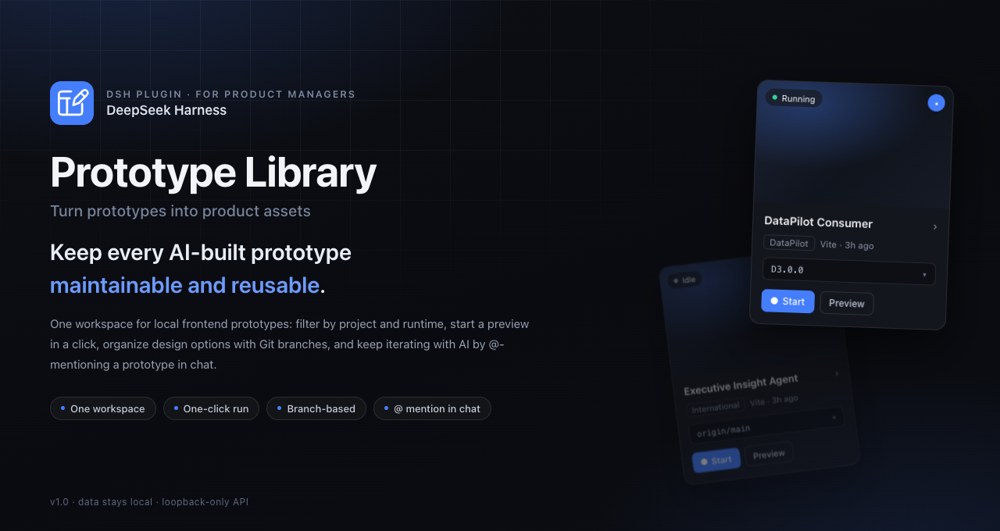
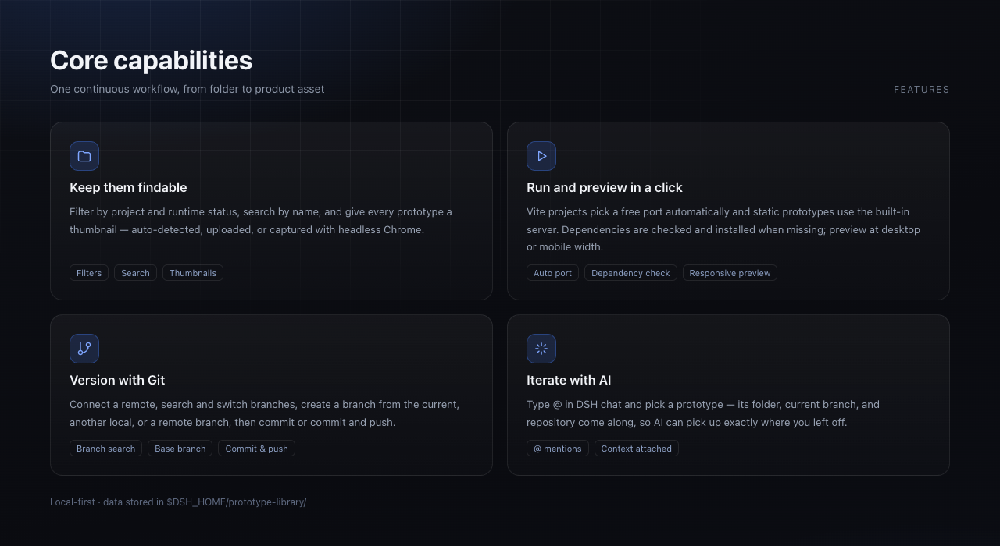
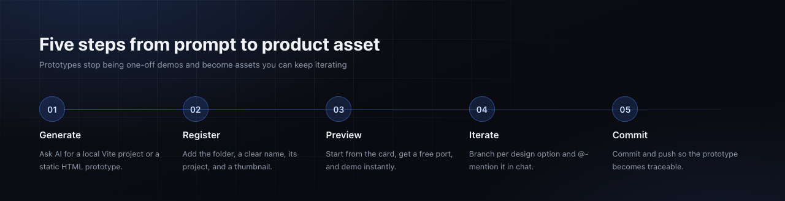

#  Prototype Library

**An AI interaction prototype workspace built for product managers.**

[中文](./README.md) | English

AI makes interactive prototypes faster to create. Keeping them organized is another story: projects end up scattered across folders, demo links are hard to find, alternative designs become difficult to distinguish, and every follow-up AI conversation starts with explaining the project location and version again.

Prototype Library is a DeepSeek Harness (DSH) plugin that brings your existing local frontend prototypes into one workspace. It helps product managers **find, preview, version, and iterate on prototypes with AI**, turning individual experiments into maintainable, reusable product assets.

## Problems it solves

| Everyday challenge for product managers | How Prototype Library helps |
| --- | --- |
| AI-generated prototypes are scattered across local folders | Register prototypes in one library with names, thumbnails, and project assignments |
| Multiple projects make it hard to find the right design for a review | Filter by project or running status, and search by name |
| Every demo requires finding a folder, opening a terminal, and starting a server | Start, stop, and open previews directly from prototype cards |
| Repeated revisions and alternative designs are difficult to maintain | Connect a Git remote, switch or create branches, and commit and push changes |
| Follow-up AI requests require copying paths and version details again | Mention a prototype with `@` in DSH chat to attach its directory, branch, and repository information |

## Core features

### 1. Keep prototypes in one place

Add existing local Vite projects or static HTML prototypes, with a name, project assignment, and thumbnail. Project and status filters, together with name search, help you find the right prototype for your next review or iteration.

Thumbnails can be discovered from screenshots in the prototype folder, uploaded manually, or captured with headless Chrome, making prototypes easier to recognize.

### 2. Get ready for demos quickly

Start or stop a prototype and open its browser preview directly from a library card. Vite projects automatically use an available port, while static HTML prototypes run through the plugin’s built-in server. The preview dialog supports desktop and mobile widths for checking interactions at different screen sizes.

Before starting a Vite prototype, the plugin checks its dependencies. For npm projects, missing or outdated dependencies are installed automatically, with progress recorded in the startup log.

### 3. Keep designs evolving with version control

Connect a prototype to a Git remote repository. Search and switch branches from the list or detail view, create branches for new design options, and commit changes or commit and push them.

New branches can start from the current branch, another local branch, or a remote branch. Product managers can organize alternatives and iterations with branches, reducing the need to maintain copied folders as separate versions.

### 4. Continue iterating with AI

Type `@` in the DSH chat input and select a managed prototype from the prototypes group. When you send the message, its directory, current branch, and repository information are attached automatically, helping AI locate the project and continue editing.

For example, select a prototype and ask: “Update the creation page in this prototype with form validation and a success state.” The request carries the prototype context into the conversation.

## A product manager’s workflow

1. **Generate a prototype**: Use AI to create a local Vite project or static HTML interactive prototype.
2. **Add it to the library**: Import the existing folder and set a recognizable name, project assignment, and thumbnail.
3. **Demo and review**: Start the prototype from its card, open the preview, and review pages and interactions.
4. **Iterate on the design**: Create or switch Git branches as needed, then mention the prototype with `@` in chat for further AI edits.
5. **Save the result**: Commit changes and push to the connected remote repository when needed.

## Installation and getting started

In DeepSeek Harness, open the plugin manager, choose the add-plugin action, and select the `dsh-prototype-library` directory. The plugin can also be installed as a bundle through the plugin manager.

After installation, a Prototype Library entry appears in the sidebar. Open it and import an existing local prototype folder to get started.

Running Vite projects requires Node.js and the appropriate package manager on your machine. Version control requires Git, and pushing requires credentials for the remote repository. Capturing thumbnails with headless Chrome requires an available local Chrome installation.

## Supported scope and behavior

- **Local prototype management**: Supports Vite projects and static HTML. Imports existing local folders; does not clone remote repositories.
- **Runtime environment**: Runs locally on macOS / Linux. The API listens only on DSH’s loopback interface.
- **Dependency installation**: For npm projects, uses `npm ci` when `package-lock.json` exists, otherwise `npm install`. Automatic installation is skipped when pnpm, yarn, or bun lockfiles are detected; prepare dependencies with the appropriate package manager.
- **Git operations**: Uses system Git. Configure SSH keys or a credential helper in advance; the plugin does not store credentials. Uncommitted changes to tracked files block branch switching.
- **Special branch-switch behavior**: If the current branch tracks `node_modules` and the target branch does not contain those dependencies, the plugin removes them from the Git index and creates a commit before switching. Dependency files remain on disk.
- **Operation limits**: Does not offer discarding working changes, `reset --hard`, `clean`, or force push.
- **Removing a prototype**: Deletes only its registration and thumbnail, leaving the source folder intact.
- **Process management**: The plugin manages preview processes and attempts to stop processes it started when the plugin is uninstalled or DSH restarts.

## Data storage

Plugin data is stored in `$DSH_HOME/prototype-library/`:

| File or directory | Purpose |
| --- | --- |
| `registry.json` | Prototype registry |
| `servers.json` | Runtime process records used to clean up orphaned processes after restart |
| `thumbnails/` | Prototype thumbnails |
| `logs/` | Startup logs |
| `tmp/` | Temporary screenshot files |
