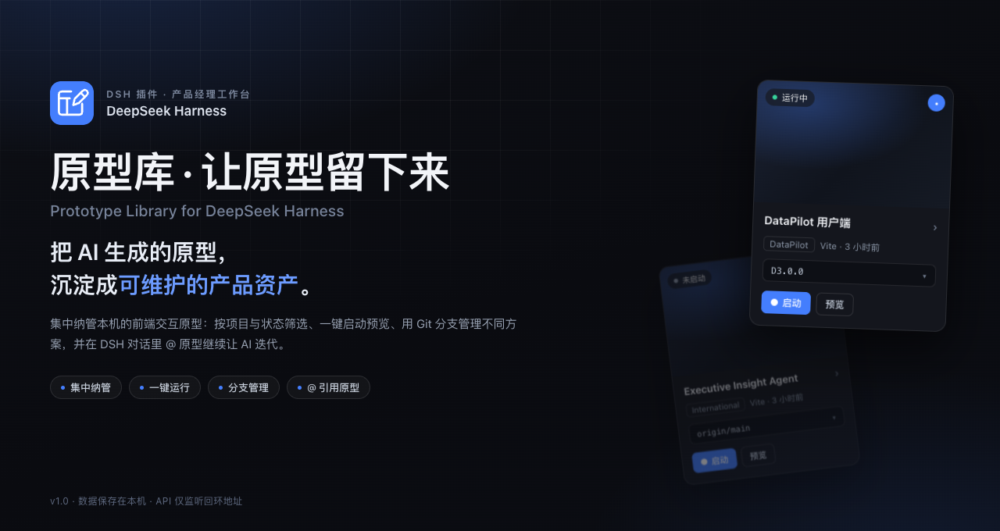
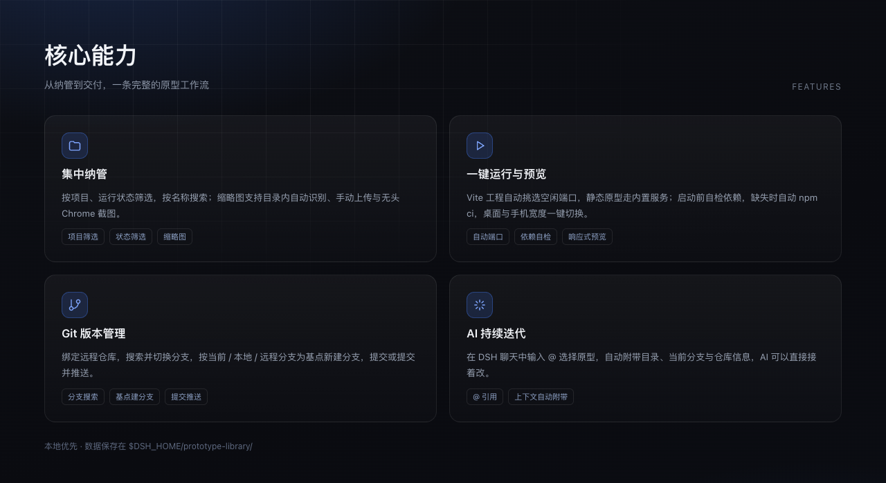
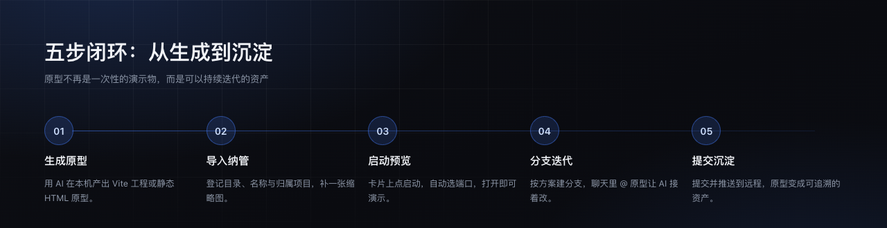

#  原型库 · Prototype Library

**为产品经理打造的 AI 交互原型管理工作台。**

中文 | [English](./README.en.md)

AI 让生成交互原型变得更快，但生成之后的管理往往跟不上：原型散落在不同目录，评审前找不到入口，多个方案难以区分，后续修改还要重新向 AI 交代项目位置与版本。

原型库是 DeepSeek Harness（DSH）插件，将本机已有的前端交互原型集中纳管，让产品经理在一个入口完成**查找、预览、版本管理和 AI 持续迭代**，把一次性的原型产出积累为可维护、可复用的产品资产。

## 解决哪些问题

| 产品经理的日常痛点 | 原型库如何帮助你 |
| --- | --- |
| AI 生成的原型散落各处，时间一长就找不到 | 统一登记本地原型，以名称、缩略图和归属项目集中展示 |
| 同时推进多个项目，难以快速定位要评审的方案 | 按项目、运行状态筛选，按名称搜索 |
| 每次演示都要找目录、开终端、启动服务 | 在原型卡片上直接启动、停止和打开预览 |
| 多个需求方案反复修改，版本难以维护 | 绑定 Git 仓库，切换或新建分支，提交并推送修改 |
| 继续让 AI 修改时，要反复粘贴路径和版本信息 | 在 DSH 聊天中 `@` 选择原型，自动附带目录、分支与仓库信息 |

## 核心功能

### 1. 集中管理，让原型找得到

将本机已有的 Vite 工程或静态 HTML 原型加入原型库，维护名称、归属项目与缩略图。通过项目筛选、状态筛选和名称搜索，快速找到下一次评审或迭代需要的原型。

缩略图支持自动发现目录内截图、手动上传，以及通过无头 Chrome 截图，帮助你直观识别不同原型。

### 2. 快速预览，让演示随时开始

在列表卡片上直接启动或停止原型，并打开浏览器预览。Vite 工程自动选择空闲端口，静态 HTML 原型通过插件内置服务运行；预览弹窗支持桌面和手机宽度，方便检查不同屏幕下的交互表现。

启动 Vite 原型时自动检查依赖。对于使用 npm 的项目，缺失或过期的依赖会自动安装，安装过程可在启动日志中查看。

### 3. 管理版本，让方案持续演进

将原型绑定到 Git 远程仓库，在列表或详情中搜索、切换分支，为新的需求方案创建分支，并提交或提交并推送修改。

新分支可基于当前分支、本地分支或远程分支创建。产品经理可以用分支组织不同方案与迭代，减少靠复制文件夹区分版本的维护负担。

### 4. 连接 AI，让修改接得上

在 DSH 聊天输入框输入 `@`，从「原型」分组选择已纳管的原型。发送消息时会自动附带原型目录、当前分支与仓库信息，便于 AI 定位工作对象、继续修改。

例如：选择一个原型后，告诉 AI「调整这个原型的新增页面，补充表单校验与提交成功状态」，即可带着原型上下文继续沟通需求。

## 产品经理的使用流程

1. **生成原型**：使用 AI 在本机生成 Vite 工程或静态 HTML 交互原型。
2. **加入原型库**：导入已有目录，设置便于识别的名称、归属项目和缩略图。
3. **演示与评审**：从卡片启动原型，打开预览，检查页面和交互。
4. **迭代方案**：按需要创建或切换 Git 分支，在聊天中 `@` 原型，让 AI 继续调整。
5. **保存成果**：提交修改，需要时推送到已绑定的远程仓库。

## 安装与开始使用

在 DeepSeek Harness 中打开「插件」→「+ 添加插件」，选择 `dsh-prototype-library` 插件目录；也可由插件管理器以 bundle 形式安装。

安装后，侧栏会出现「原型库」入口。进入后导入本机已有原型目录，即可开始管理。

运行 Vite 工程需要本机具备 Node.js 与对应包管理器；使用版本管理功能需要安装 Git，推送前需配置好远程仓库访问凭据。通过无头 Chrome 生成缩略图需要本机具备可用的 Chrome。

## 支持范围与使用说明

- **本地原型纳管**：支持 Vite 工程与静态 HTML，仅导入本机已有目录，不从远程仓库克隆。
- **运行环境**：支持 macOS / Linux 本机运行，API 仅监听 DSH 的本地回环地址。
- **依赖安装**：npm 项目优先执行 `npm ci`，没有 `package-lock.json` 时执行 `npm install`；检测到 pnpm、yarn 或 bun 锁文件时跳过自动安装，请使用对应包管理器自行准备依赖。
- **Git 操作**：使用系统 Git；SSH key 或 credential helper 需提前配置，插件不保存凭据。存在未提交的已跟踪文件改动时会阻止切换分支。
- **分支切换的特殊处理**：若当前分支跟踪了 `node_modules`，且目标分支不包含这些依赖，插件会先将其从 Git 索引移除并自动提交，再继续切换；磁盘上的依赖会保留。
- **操作边界**：不提供丢弃工作区改动、`reset --hard`、`clean` 或强制推送。
- **移除纳管**：只删除注册记录与缩略图，不删除原型源目录。
- **进程管理**：预览进程由插件管理；插件卸载或 DSH 重启时会尝试停止由它启动的进程。

## 数据存储

插件数据保存在 `$DSH_HOME/prototype-library/`：

| 文件或目录 | 用途 |
| --- | --- |
| `registry.json` | 原型注册表 |
| `servers.json` | 运行时进程记录，用于重启后清理孤儿进程 |
| `thumbnails/` | 原型缩略图 |
| `logs/` | 启动日志 |
| `tmp/` | 截图临时文件 |
